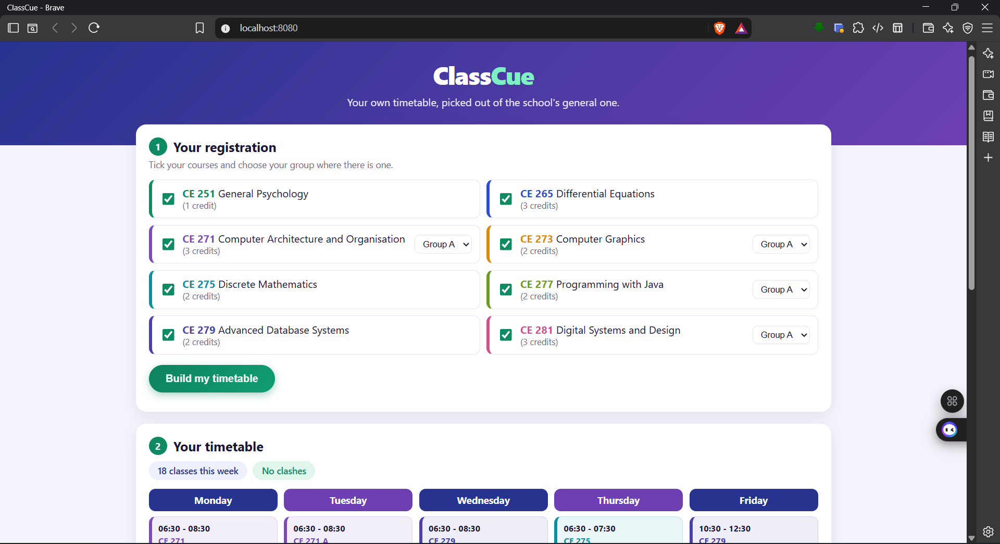

# ClassCue

A web app that turns the school's general timetable into **your own** timetable, then fits study blocks around your classes.



## Problem

The school publishes one general timetable for everyone. Each student has to pick out their own courses by hand and work out where their free time is. This is slow and error-prone, and it leads to missed classes and poorly planned study time.

## Solution

ClassCue stores the general timetable in a database and gives each student only the classes they are registered for.

1. **Registration:** the student ticks their courses and picks their group (A or B) where a course has groups.
2. **Class timetable:** ClassCue shows a Monday to Friday schedule of just those classes and flags any clash, for example two classes at the same time.
3. **Study plan:** the student sets study hours per week, a preferred time of day, days to keep free and their hardest courses. ClassCue places study blocks in the free gaps between classes.

## Tech

| Layer | Technology | Status |
|---|---|---|
| Database | MySQL 8.0 | Built |
| Server | Java 21 (built-in `HttpServer`, JDBC) | Built |
| Interface | HTML, CSS, JavaScript | Built |
| Scheduling engine | C++ | Planned |

## How the pieces fit

```
Browser (web/)  <-->  Java server (server/src)  <-->  MySQL (database/)
 registration          /api/courses                    courses
 timetable grid        /api/timetable                  timetable_slots
 study plan form       /api/plan
```

- `StudentFilter` keeps only the classes a student is registered for. Slots with no group are for everyone, and grouped slots are kept only for the chosen group.
- `ClashDetector` marks two classes as clashing when each starts before the other ends. Different groups of the same course are not a clash.
- `Planner` finds the free hours between classes inside the preferred time window, skips days kept free, and spreads the study blocks across the week.

## Project structure

```
classcue/
├── database/
│   ├── schema.sql                 creates the tables
│   ├── seed_ce200.sql             CE Level 200 courses and 23 weekly slots
│   ├── update_titles_credits.sql  course titles and credits
│   └── wednesday_query.sql        demo query: Wednesday's classes
├── server/src/
│   ├── Server.java                web server and API
│   ├── Main.java                  loads data from MySQL, console demo
│   ├── Db.java                    database connection
│   ├── TimetableSlot.java         one class meeting
│   ├── StudentFilter.java         registration filter
│   ├── ClashDetector.java         clash detection
│   └── Planner.java               study-block planner
├── web/
│   ├── index.html
│   ├── style.css
│   └── app.js
├── engine/                        C++ engine (planned)
└── docs/
    └── screenshot.png
```

## Getting started

You need: JDK 21, MySQL 8.0 and MySQL Workbench, and IntelliJ IDEA.

**1. Create the database.** In MySQL Workbench, open and run these in order:

1. `database/schema.sql`
2. `database/seed_ce200.sql`
3. `database/update_titles_credits.sql`

Then check it with `database/wednesday_query.sql`. It should return 5 classes, and CE 277 B and CE 273 A both start at 10:30.

**2. Add the MySQL driver.** In IntelliJ: File, Project Structure, Libraries, **+**, From Maven, and add `com.mysql:mysql-connector-j:8.4.0`. Mark `server/src` as the Sources Root.

**3. Set the database password.** The password is never stored in the code. In Run, Edit Configurations, add this environment variable to the run configuration for `Server` (and for `Main` if you run it):

```
CLASSCUE_DB_PASSWORD=your_mysql_root_password
```

**4. Run the server.** Run `Server`, then open http://localhost:8080 in a browser.

## API

| Address | Returns |
|---|---|
| `GET /api/courses` | All courses with title, credits and available groups |
| `GET /api/timetable?reg=CE 271:A,CE 277:B` | The student's classes and any clashes |
| `GET /api/plan?reg=...&hours=8&from=17&to=22&free=Friday&focus=CE 273` | Study blocks placed in the free gaps |

`reg` lists the registered courses, each as `code:group` (leave the group empty for courses without groups).

## Status

**Built**
- Database design and the real CE Level 200 timetable (8 courses, 23 weekly slots)
- Java layer that reads the timetable from MySQL
- Class filtering by registered courses and groups
- Clash detection (currently in Java)
- Study-block planner
- Web interface for registration, timetable and study plan

**Planned**
- C++ scheduling engine for clash detection and gap-filling
- Reading the school's Excel timetable directly (the data is currently loaded from a seed file)
- Saving a student's registration and preferences
- Support for other programmes and levels

## Notes

- The data covers CE Level 200, Semester 1, 2026/2027. Check times against the school's official timetable.
- This is a student project in active development.
